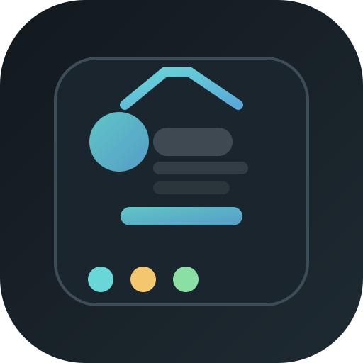
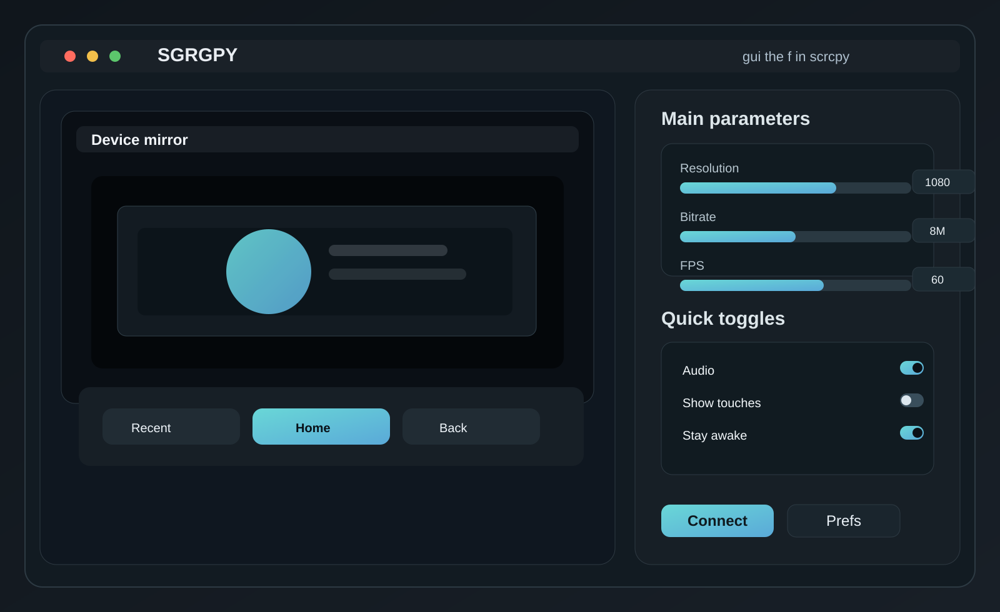

# SGRGPY

SGRGPY is a macOS-first desktop GUI for `scrcpy` designed to make the powerful Android screen-mirroring tool more approachable for everyday use on Apple hardware.

It wraps `scrcpy` without replacing it: the app generates native macOS controls, stores settings, and launches the real `scrcpy` binary with the correct options. That keeps compatibility with current `scrcpy` releases while giving the app a polished desktop shell.

The project is built around the design direction you requested:
- a minimal neutral palette with a blue-green accent
- standard macOS window chrome and traffic-light buttons
- large high-visibility controls for Resolution, Bitrate, and FPS
- Android-style bottom nav with Recent / Home / Back
- a preferences window accessible via `Command + ,`
- profile presets, appearance settings, and pull destination management
- a clean UI inspired by modern design systems like Tabler

## Tagline

`gui the f in scrcpy`

## Features

- macOS 12+ support
- Mirror mode and extended display mode
- slider controls and keyboard-editable numeric fields
- preset profiles for common device setups
- appearance selection and preference panel
- configurable pull destination for recordings
- audio, fullscreen, stay-awake, touch overlay, and recording toggles
- generated `.app` bundle for double-click launch on macOS

## Screenshots





## Requirements

- macOS 12 Monterey or newer
- Xcode Command Line Tools (`xcode-select --install`)
- `scrcpy` installed and available on PATH, or set `SCRCPY_BIN` to the binary path

Install `scrcpy` with Homebrew:

```bash
brew install --cask android-platform-tools
brew install scrcpy
```

If `scrcpy` is not in your PATH, add one of the following:

```bash
export SCRCPY_BIN=/opt/homebrew/bin/scrcpy
```

or put the binary into:

- `/opt/homebrew/bin/scrcpy`
- `/usr/local/bin/scrcpy`

## Quick start

```bash
cd sgrgpy
./build_app.sh
```

This generates:

```text
dist/SGRGPY.app
```

Double-click it in Finder to launch.

## App behavior

The app launches the real `scrcpy` binary with parameters derived from the UI:

- resolution (`--max-size`)
- bitrate (`--bit-rate`)
- FPS (`--max-fps`)
- mirror vs extended display (`--new-display`)
- audio (`--no-audio` when disabled)
- show touches (`--show-touches`)
- stay awake (`--stay-awake`)
- fullscreen (`--fullscreen`)
- recording (`--record <destination>`) when enabled

## Project structure

```text
sgrgpy/
├── Package.swift
├── build_app.sh
├── README.md
├── Sources/
│   └── SGRGPY/
│       └── main.swift
├── assets/
│   ├── icon.svg
│   ├── screenshot-main.svg
│   └── screenshot-preferences.svg
└── dist/
    └── SGRGPY.app   (generated)
```

## Design notes

The interface is intentionally designed around the following principles:

- minimal chrome
- native macOS interaction patterns
- neutral base colors with one accent color for emphasis
- simple sliders plus direct numeric entry for precision
- a compact, modern dashboard view centered on a main device preview

The visual direction is inspired by modern design systems such as Tabler and the tabler-icons collection, while staying intentionally light and uncluttered.

## Roadmap

Planned enhancements include:

- a polished light-mode palette and system appearance support
- a better `Device` selection dropdown for serials and wireless devices
- custom icon set and app bundle metadata refinement
- more advanced preset management and export/import
- a full settings schema and persistence layer with robust validation

## License

This project is built as a macOS desktop front-end for `scrcpy` and is intended to be used with the upstream tool. It follows the same spirit of open-source tooling and is intentionally lightweight and easy to build.

## Credits

- `scrcpy` upstream: Genymobile / Romain Vimont
- Design inspiration: Tabler, tabler-icons, and minimal native macOS UX patterns
